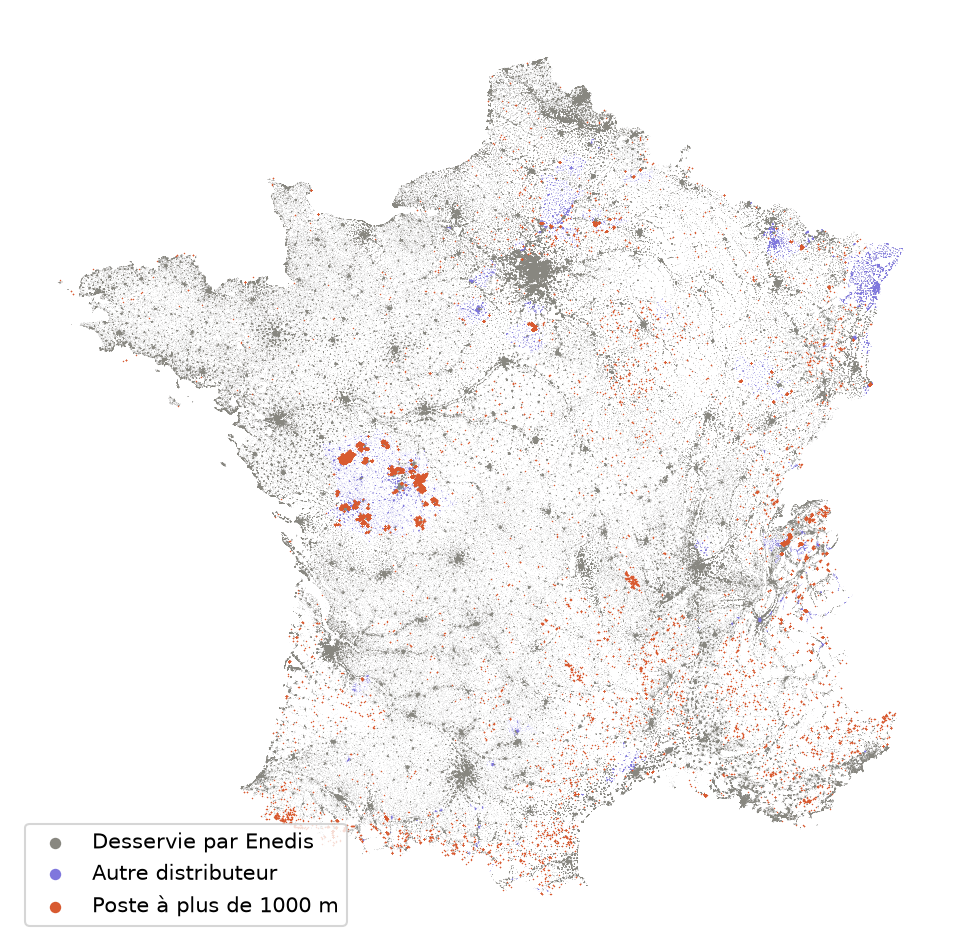
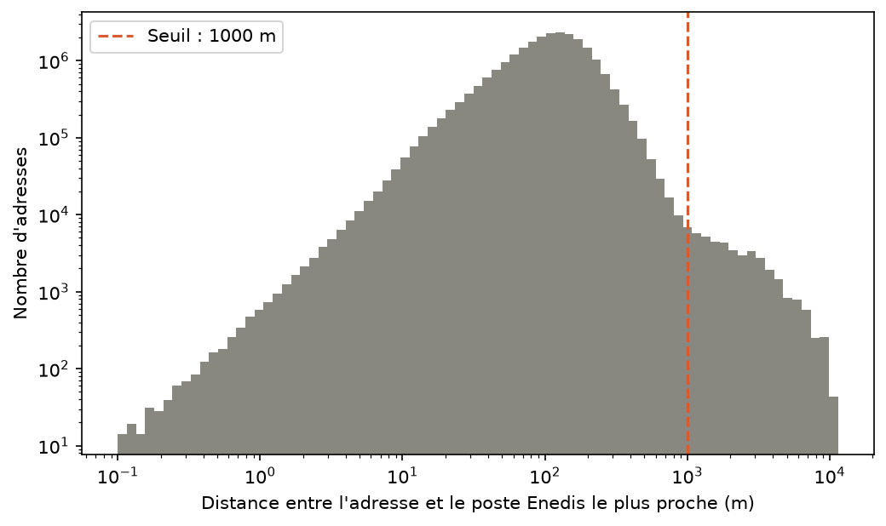

# Rattachement des adresses aux postes électriques

[](https://github.com/devlud/rattachement-adresses-postes/actions/workflows/tests.yml)

Pour chacune des 25 millions d'adresses de la Base Adresse Nationale (BAN), trouver le poste de
distribution HTA/BT d'Enedis le plus proche, uniquement à partir de données ouvertes.

Un projet de data science de bout en bout : téléchargement, contrôle qualité, calcul spatial,
passage à l'échelle avec Spark, analyse des résultats, tests automatiques.



*En gris, les adresses desservies par Enedis. En violet, celles d'un autre distributeur.
En corail, les adresses à plus d'un kilomètre de leur poste.*

## Les résultats en bref

| France continentale, hors Corse | |
|---|---|
| Adresses valides de la BAN | 25 115 958 |
| Adresses desservies par Enedis, rattachées à un poste | 23 941 464 (95,3 %) |
| Adresses hors du périmètre d'Enedis | 1 174 494 (4,7 %) |
| Postes HTA/BT d'Enedis | 976 678 |
| Distance médiane entre une adresse et son poste | 110 m |
| 99 % des adresses sont à moins de | 453 m |
| Rattachements jugés suspects (poste à plus de 1 km) | 41 950 (0,18 %) |

## Ce que les données m'ont appris

### 1. Enedis n'est pas le seul distributeur d'électricité

Au premier calcul sur toute la France, la moitié des adresses du Bas-Rhin étaient à plus de
14,5 km de leur poste, et 80 % à plus de 2 km. C'est impossible dans un département aussi dense :
ces adresses ne sont pas desservies par Enedis, mais par Strasbourg Électricité Réseaux, une
entreprise locale de distribution (ELD). Il en existe plus d'une centaine : Gérédis dans les
Deux-Sèvres, SRD dans la Vienne, Réséda à Metz, GreenAlp à Grenoble...

Correction : la liste officielle du distributeur de chaque commune, publiée par l'Agence ORE.
Seules les adresses desservies par Enedis cherchent désormais un poste Enedis.
Les adresses à plus de 2 km de leur poste sont passées de 818 240 à 18 091 (−98 %).

### 2. Les communes à deux distributeurs

Parmi ces 18 091 adresses, au moins 91 % sont dans une commune desservie à la fois par Enedis
et par une ELD. La liste officielle est donnée par commune : elle ne dit pas qui dessert chaque
rue. Ces communes sont signalées dans les résultats (colonne `commune_mixte`).

### 3. Un seuil choisi d'après les données



| Distance au poste | Adresses |
|---|---|
| de 500 m à 1 km | 129 708 |
| de 1 km à 1,5 km | 15 319 |
| de 1,5 km à 2 km | 8 540 |

Jusqu'à 1 km, le nombre d'adresses s'effondre (8,5 fois moins d'une tranche à la suivante).
Au-delà, il ne baisse plus que lentement (1,8 fois moins) : on entre dans les anomalies.
C'est aussi la limite de plausibilité d'un raccordement en basse tension.
Seuil retenu : 1 km, plutôt qu'une règle « moyenne + 3 écarts-types », trompeuse sur une
distribution aussi asymétrique.

### 4. La qualité de la BAN

- Certains identifiants apparaissent deux fois : la même adresse, positionnée à quelques
  dizaines de mètres d'écart (444 dans le Rhône, 8 085 dans le Var). On garde la première.
- Aucune adresse n'enfreint les règles de qualité (coordonnées en France, code INSEE à 5
  chiffres). Les adresses en faute seraient mises de côté dans un fichier, jamais supprimées
  en silence.

## Méthode

| Étape | Module | Rôle |
|---|---|---|
| Téléchargement | `telechargement.py` | BAN par département, postes par l'API d'Enedis (page par page), liste des distributeurs ; chaque téléchargement est noté dans un journal |
| Contrôle qualité | `qualite.py` | Règles pandera : doublons, code INSEE, coordonnées |
| Libellés | `texte.py` | « 12 bis av. Jean-Jaurès » devient « 12 BIS AVENUE JEAN JAURES » |
| Périmètre | `perimetre.py` | Distributeur de chaque commune, communes mixtes |
| Poste le plus proche | `plus_proche.py` | Jointure spatiale GeoPandas, avec index spatial ; égalités départagées par l'identifiant du poste ; vérifié contre un calcul exhaustif |
| Pipeline | `pipeline.py` | Tout enchaîner, département par département ; résultats en Parquet et bilan |
| Spark | `plus_proche_spark.py` | Le même calcul avec Spark, comparé à GeoPandas |
| Statistiques | `statistiques.py` | Chiffres clés, histogramme et carte |

Toute la France est traitée en quelques minutes sur un ordinateur portable : quelques secondes
par département.

## Passer à l'échelle avec Spark

Spark n'a pas d'index spatial. Le calcul utilise donc une grille : chaque adresse n'est comparée
qu'aux postes de sa case et des 8 cases voisines. Si le meilleur candidat est à moins d'une case
de distance, c'est forcément le plus proche de tous. Sinon, l'adresse recommence avec des cases
plus grandes, de 200 m à 50 km. Le résultat est exact : les tests vérifient que Spark et
GeoPandas trouvent les mêmes postes.

Sur un seul ordinateur, GeoPandas reste le bon outil. Spark devient utile quand les données ne
tiennent plus sur une machine, par exemple pour relier ces adresses aux relevés des compteurs.

## Installation et utilisation

```bash
git clone https://github.com/devlud/rattachement-adresses-postes.git
cd rattachement-adresses-postes
python3 -m venv .venv
source .venv/bin/activate
pip install -e ".[dev]"     # ou ".[dev,spark]" pour Spark, qui demande Java 17 ou plus
pytest
```

```bash
python -m rattachement.pipeline 69            # un département, ou « tous »
python -m rattachement.statistiques           # chiffres clés et images
python -m rattachement.plus_proche_spark 69   # comparaison entre Spark et GeoPandas
```

Les données sont téléchargées dans `data/`, qui n'est pas versionné.

## Tests

32 tests (pytest), lancés automatiquement par GitHub Actions à chaque envoi, avec une
vérification du style du code (ruff).

## Limites et pistes d'amélioration

- **Le distributeur est connu par commune.** Dans les communes mixtes, on ne sait pas qui
  dessert chaque adresse. Piste : les postes des autres distributeurs, ou le référentiel
  interne qui relie chaque compteur à son poste.
- **Un seul seuil pour toute la France.** 1 km n'a pas le même sens à Paris et en Lozère.
  Piste : un seuil par type de territoire (grille de densité de l'INSEE), ou relatif à la
  distance habituelle dans la commune.
- **Le plus proche à vol d'oiseau** n'est pas toujours le poste de raccordement réel, car le
  réseau suit les rues. Piste : une distance le long du réseau routier.
- **Une erreur arrête tout le pipeline.** Piste : isoler les erreurs par département et
  reprendre là où le calcul s'est arrêté.
- **Spark et GeoPandas ensemble** (`applyInPandas`), quand PySpark prendra en charge pandas 3,
  ou Apache Sedona, qui ajoute des index spatiaux à Spark.

## Données

| Données | Source | Licence |
|---|---|---|
| Base Adresse Nationale | [adresse.data.gouv.fr](https://adresse.data.gouv.fr) | Licence Ouverte 2.0 |
| Postes électriques HTA/BT | [Open data Enedis](https://opendata.enedis.fr) | Licence Ouverte 2.0 |
| Distributeurs de gaz et d'électricité par commune | [Agence ORE, sur data.gouv.fr](https://www.data.gouv.fr/datasets/distributeurs-de-gaz-et-delectricite-par-commune) | Licence Ouverte 2.0 |

## Auteur

Ludovic Ravenach, data scientist. Code sous licence MIT.
